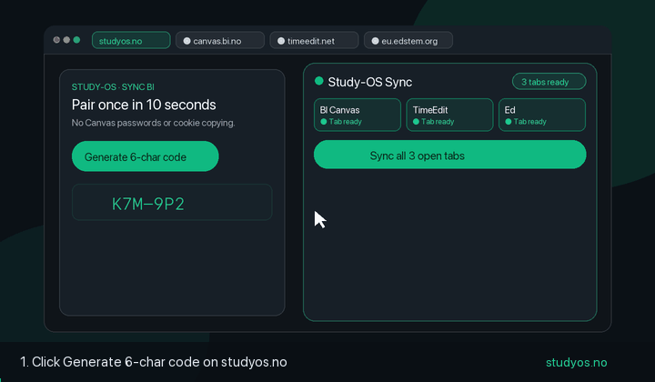

# Study-OS · BI Oslo Exam Prep & Study Workspace

**[Open Study-OS (`https://studyos.no`)](https://studyos.no/)** · [BI Oslo Guide](https://studyos.no/bi-oslo.html) · [Norsk (BI Oslo)](https://studyos.no/norsk.html) · [WISEflow Practice](https://studyos.no/wiseflow-practice.html) · [BI Canvas & TimeEdit Sync](https://studyos.no/bi-canvas-timeedit-sync.html) · [Course Notes](https://studyos.no/notes.html)

Open-source (`MIT`), zero-dependency university practice engine built for **Oslo / BI Norwegian Business School** courses (**[EXC 3420](https://studyos.no/courses/econ-2522.html)**, **[EXC 3430](https://studyos.no/courses/acct-2527.html)**, **[EXC 3460](https://studyos.no/courses/ob-2537.html)**, **[EBA 3400](https://studyos.no/courses/prog-3021.html)**, **[EBA 1181](https://studyos.no/courses/math-2588.html)**) — **1,039 exercises**, **3-pane side-by-side workspace (`Task | Reference | Answer`)**, **WISEflow `FLOWmulti` (`±2%`) exam simulator**, **Rated BI Duels & Live Group Study Pods**, **Adaptive Timetable + Study Debt Rollover**, **AI Tutor (`Al`)**, and 1-click **BI Canvas / TimeEdit / Ed Discussion** browser sync.

<p align="center">
  
</p>

## Highlights

- **3-Pane Side-by-Side Workspace**: View **Task / Cropped Inline PDF**, **Course Reference Notes**, and **Answer / Worksheet** simultaneously on desktop with draggable dividers, or keep compact Focus/Split mode on smaller screens.
- **Study Together & Rated BI Duels (Beta)**: Challenge BI classmates to 5-minute 1v1 rated Elo duels across **Accounting (`EXC 3430`)**, **Economics (`EXC 3420`)**, **Maths (`EBA 1181`)**, or **Mixed BI Blitz**, or join open **25m / 50m / 75m Group Study Pods** with live course badges, 1-click invite links (`?join_room=...`), Global Chat challenge cards, and instant rematches.
- **Course Explorer & Provenance Badges**: Direct 1-click course pills, composable **`Real BI Tasks Only`** + **`Past Exams`** + **`High/Med/Low DLPFC`** filter chips, 3-state clickable table header sorting, and clear source/LLM provenance labels.
- **Scheduled Queue with Early Completion & Study Debt Rollover**: Plan around TimeEdit lectures & part-time shifts, complete upcoming study blocks ahead of schedule (`Done early ✓`), and roll missed blocks into a visible **Study Debt** stack until cleared.
- **1-Click BI Canvas, TimeEdit & Ed Sync (`Study-OS Sync v1.5.1`)**: Pair once with a 6-character code, auto-refresh open BI tabs, and auto-load BI Canvas PDFs privately inline inside Chrome (strictly local in browser IndexedDB — copyrighted university files & publisher textbooks are never uploaded).
- **Offline & Mobile Support**: Select **Save for offline** or install as a PWA; use Google / Passkey cloud sync or **Export / Import Backup** to carry progress, attempts, drafts, and schedules across desktop and phone.

## Full member library

Open the website and paste the shared access string when prompted. The library opens in the same browser tab and adds the complete local question banks, linked source excerpts, and the searchable **Original course files** list to each subject. Protected files open while online. The public notes and practice can be saved for offline use.

Before sharing the string, confirm that you have permission to host and share each included work with the intended group. Send the string privately to approved recipients. Study-OS decrypts the library in the browser. **Remember on this browser** stores a non-extractable browser key. **Lock full library** clears that saved key. Recipients may retain files they download.

To update the library, run `tools/build_member_library.py` using Python with `cryptography`, passing the local Study-OS, Canvas Archive and Obsidian Vault paths. Keep the key file outside Git. Upload the encrypted archive as `study-os-members.zip` to a new GitHub prerelease, and set the release tag and archive SHA-256 in `site-pack/member-archive.json`. For a replacement string, build with a new key file or `--rotate-key`. Retire the old release after the new one is live. Old keys can still open encrypted copies already downloaded with that key.

## AI and MCP

Start the local desktop app and register a stdio MCP server with your AI client. Use `uv` as the command and `run --script /absolute/path/to/Study-OS/tools/study_os_mcp.py` as its arguments. The bridge uses the official MCP Python SDK and connects to the app on port 8765. Add `--port` after the script path if the local app uses another port.

The tools can find subjects and questions, read the notes for an exercise, show study reports, and preview or replace the active schedule inside Study-OS. Google Calendar access remains read-only. The [study set tool](docs/study-sets-mcp.md) turns an AI-generated set into a link you can open and save on a break.

Community profiles, the leaderboard and direct messages use a separate [community backend](community/README.md).

## Desktop setup

Use the desktop edition to study from your own Canvas Archive and Obsidian Vault. [Download the source ZIP](https://github.com/shadjosef/study-os/archive/refs/heads/main.zip), extract it, and install Python 3.9 or later. On Windows, install the time zone database with `py -3 -m pip install tzdata` before starting the app.

For one-click course and deadline updates from your signed-in BI Canvas tab, set up [Canvas Browser Sync](docs/canvas-browser-sync.md).

1. **Sync your Canvas courses once via cookie session ([`canvas-study-sync`](https://github.com/shadjosef/canvas-study-sync))**:
   - Clone or unzip [`canvas-study-sync`](https://github.com/shadjosef/canvas-study-sync) into `Canvas-Archive/` and place `Study-OS/` right next to it (e.g. inside `Documents` or OneDrive).
   - Double-click **`Study OS.app`** / **`OPEN_STUDY_OS.command`** (macOS) or **`OPEN_STUDY_OS.cmd`** (Windows) — requires only **Python 3.9+ stdlib** (`0` pip packages).
   - In the desktop Study-OS hub, click **Sync Canvas** and paste the `canvas_session` value from your signed-in browser. The installed Canvas Sync worker downloads your course files and timetable locally. Study-OS shows progress and clears the session field when you start.
   - Use **Sync Ed** for Ed Discussion only, or select **Canvas and Ed Discussion** to fetch both. **Get Ed token** opens the regional Ed settings. **Remember this token on this computer** uses Canvas Sync's secure store so you can leave the Ed field blank next time.
2. **Plug `Canvas-Archive` into `Study-OS` in 1 click**:
   - Use **Import new courses** after the sync, or run `python3 tools/cli.py sync-canvas --import-new`. Existing question banks are preserved. **Open standalone sync** opens Canvas Sync's advanced options.
   - **Add books or PDFs** copies your own PDF, EPUB or PowerPoint files into a course with Canvas Sync. Find them under **Course files on this device**. PDFs use the Study-OS reader. Other formats can be opened from the downloaded file.
   - Study-OS automatically pairs past exam PDFs, solution guides, problem sets, and `.ipynb` notebooks into Study-OS's **Side-by-Side Split PDF Reader**!
3. **Build Your Adaptive Schedule (`Schedule Studio` Tab)**:
   - **Option 1 (Instant Auto-Scheduler)**: Paste your **TimeEdit `.ics` link** (or upload `.ics`) + enter your **weekly part-time job hours** (`0–45h/wk`). Study-OS automatically estimates sustainable self-study hours, adjusts for lectures + work, and slots `High-dlPFC (<15:00)` / `Med-dlPFC (15–18)` / `Low-dlPFC (18+)` blocks into open gaps (exportable back to `.ics`!).
   - **Option 2 (1-Prompt Any-LLM Copy/Paste — Zero API Keys)**: Click **`1. Copy Universal LLM Schedule Prompt`**, drop it into ChatGPT, Claude, Gemini, or a local on-device LLM (`Ollama` / `LM Studio`), and paste the returned `study-os-schedule-v1` JSON (or `.ics`) straight into **`2. Paste LLM Output`**.

---

## Core Capabilities

- **WISEflow `FLOWmulti` (`±2%`) & Exam Simulator**: Blind countdown sits or guided checks, enforcing dot-decimal `.` input, leading `-` outflows, `±2%` rounding tolerance, and carry-forward intermediate answers.
- **Multi-Semester Reference Hub**: Organizes authored Obsidian Semester Reference sheets (`Autumn 2026`, `Spring 2027`, …) with section search, KaTeX math, and embedded SVG diagrams.
- **Practice and session timers**: Both clocks continue while you switch apps by default. The runner offers manual pause and optional automatic pause.
- **FSRS-5 Spaced Repetition & Universal Productivity Index (`UPI`)**: Accuracy-gated `Beat-AI` pacing (`>=85%` accuracy, `0` hints) + FSRS-5 scheduling.

---

## Publishing Your Semester Hub to GitHub Pages + Free Student Domain

 With the **GitHub Student Developer Pack** (free `.me` / `.live` / `.tech` domain via Namecheap / Name.com + free HTTPS hosting on GitHub Pages):

```bash
# 1. Snapshot your authored Obsidian Reference Sheets + copyright-safe drills into site-pack/
python3 tools/build_public_site.py --sync-pack --cname yourdomain.me

# 2. Commit & push — .github/workflows/pages.yml automatically deploys to GitHub Pages!
git add site-pack && git commit -m "chore: update semester reference pack" && git push
```

Keep personal telemetry, private builders, original university files and invite keys outside Git. The default static build exports authored reference sheets, diagrams and original practice. Publish an optional encrypted member archive only under the permissions covering its contents and hosting.

---

## CLI & AI Agent Maintenance

```bash
python3 tools/cli.py rebuild-catalog            # Validate schemas, assets & refresh Obsidian dashboard
python3 tools/cli.py sync-canvas --import-new   # Inspect Canvas-Archive & scaffold unimported courses
python3 tools/cli.py status                     # Print live UPI & course telemetry JSON
python3 tools/build_public_site.py --sync-pack  # Build static website bundle (./dist + ./site-pack)
```
