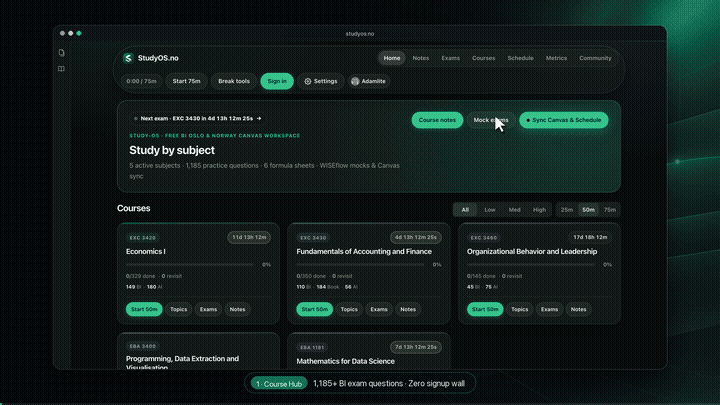
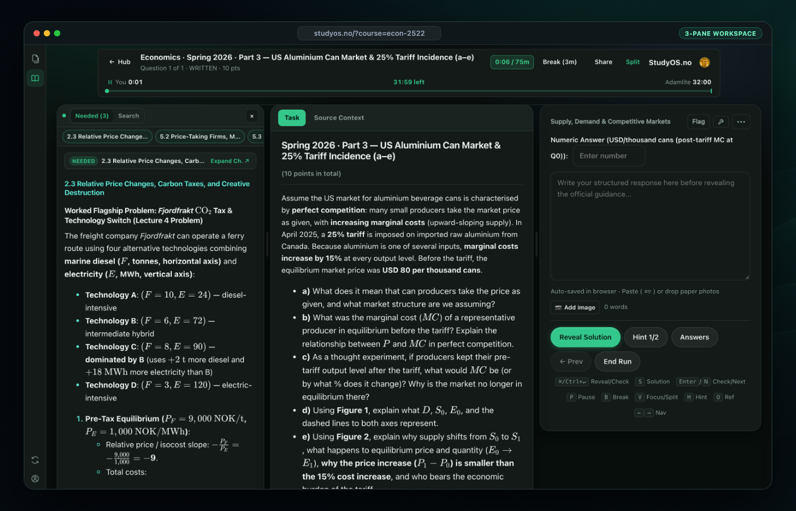
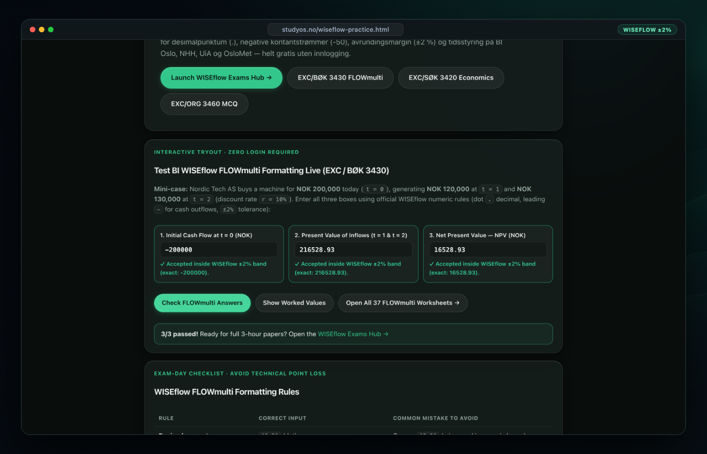
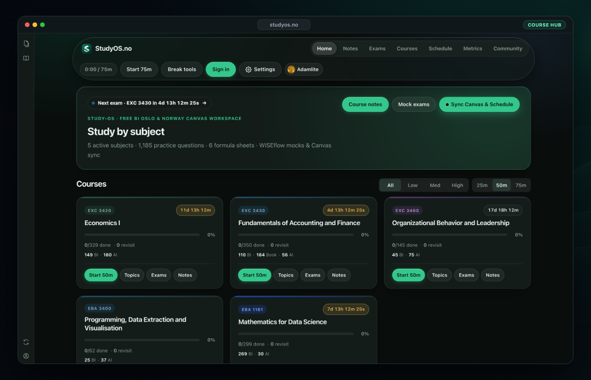
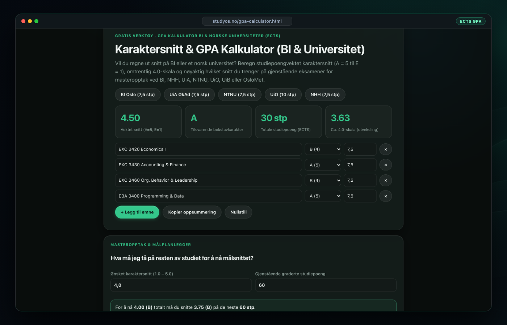
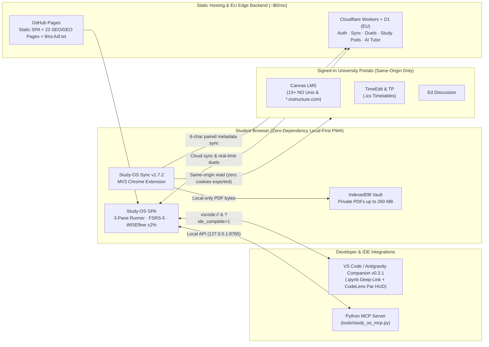

<div align="center">

<a href="https://studyos.no/">
  
</a>

<h1>Study-OS</h1>

<p><strong>Open-source, zero-dependency university exam-prep workspace for Norway &amp; Canvas LMS.</strong><br/>
3-Pane Workspace (<code>Notes | Task | Answer</code>) · BI WISEflow <code>FLOWmulti</code> (<code>±2%</code>) Simulator · 1-Click Canvas &amp; TimeEdit Sync · ECTS GPA Calculator</p>

<p>
  <a href="https://github.com/shadjosef/study-os/actions/workflows/ci.yml"></a>
  <a href="https://github.com/shadjosef/study-os/actions/workflows/pages.yml"></a>
  <a href="https://studyos.no/"></a>
  <a href="https://studyos.no/wiseflow-practice.html"></a>
  <a href="LICENSE"></a>
</p>

<p>
  <a href="https://studyos.no/"><strong>Launch Study-OS ↗</strong></a> ·
  <a href="https://studyos.no/wiseflow-practice.html">WISEflow Simulator</a> ·
  <a href="https://studyos.no/gpa-calculator.html">GPA Calculator</a> ·
  <a href="https://studyos.no/bi-canvas-timeedit-sync.html">Canvas Sync</a> ·
  <a href="https://studyos.no/bi-oslo.html">BI Oslo Guide</a> ·
  <a href="https://studyos.no/norsk.html">Norsk</a> ·
  <a href="https://studyos.no/universities.html">13+ Universities</a>
</p>

<br/>

<a href="https://studyos.no/">
  
</a>

</div>

---

## Product Showcase

Built in Oslo, Norway for **BI Norwegian Business School**, **UiA**, **NTNU**, **UiO**, **NHH**, **UiB**, **OsloMet**, **UiS**, **UiT**, **USN**, **NMBU**, **HVL**, **Kristiania**, and any `*.instructure.com` Canvas school — **100% free, ad-free, local-first, and EU GDPR-compliant**.

<table>
  <tr>
    <td width="50%" align="center">
      <a href="https://studyos.no/"></a><br/>
      <strong>3-Pane Exam Workspace (<code>Notes | Task | Answer</code>)</strong><br/>
      <sub>Context-matched KaTeX reference sheets, live AI-Par pace bar &amp; keyboard shortcuts</sub>
    </td>
    <td width="50%" align="center">
      <a href="https://studyos.no/wiseflow-practice.html"></a><br/>
      <strong>BI WISEflow <code>FLOWmulti</code> (<code>±2%</code>) Simulator</strong><br/>
      <sub>Enforces dot-decimals (<code>.</code>), leading minus (<code>-</code>) outflows &amp; ±2% tolerance live</sub>
    </td>
  </tr>
  <tr>
    <td width="50%" align="center">
      <a href="https://studyos.no/"></a><br/>
      <strong>Zero-Friction Course Hub (1,185+ Qs)</strong><br/>
      <sub>5 core BI subjects (EXC 3420/3430/3460, EBA 3400/1181) ready instantly without login</sub>
    </td>
    <td width="50%" align="center">
      <a href="https://studyos.no/gpa-calculator.html"></a><br/>
      <strong>Norwegian ECTS GPA &amp; Master's Planner</strong><br/>
      <sub>Weighted <code>A=5..E=1</code> + 4.0 conversion &amp; target grade calculator for MSc admission</sub>
    </td>
  </tr>
</table>

### 1-Click Canvas, TimeEdit / TP & Ed Browser Sync (`Study-OS Sync v1.7.2`)

Pair once with a 6-character code to sync courses, deadlines, timetables, and private on-device Canvas PDFs (stored strictly in IndexedDB — zero passwords or cookies ever leave your browser).

<p align="center">
  
</p>

<details>
<summary><strong>Watch the 10-second 1-click pairing &amp; auto-sync animation</strong></summary>
<p align="center">
  
</p>
</details>

---

## Key Capabilities

- **3-Pane Side-by-Side Workspace**: View **Course Reference Notes**, **Task / Cropped Inline PDF**, and **Answer / Worksheet** simultaneously on desktop with draggable dividers, or toggle Focus/Split mode with `V`.
- **BI WISEflow `FLOWmulti` (`±2%`) & Exam Simulator**: Timed 180-minute blind mock exams enforcing dot-decimal (`.`) input, leading minus (`-`) cash outflows, `±2%` numeric tolerance, and carry-forward intermediate checks across 37 multi-box worksheets and 1,185 total questions (**[EXC/SØK 3420](https://studyos.no/courses/econ-2522.html)**, **[EXC/BØK 3430](https://studyos.no/courses/acct-2527.html)**, **[EXC/ORG 3460](https://studyos.no/courses/ob-2537.html)**, **[EBA 3400](https://studyos.no/courses/prog-3021.html)**, **[EBA 1181/1180](https://studyos.no/courses/math-2588.html)**).
- **1-Click Canvas, TimeEdit/TP & Ed Sync (`Study-OS Sync v1.7.2`, Manifest V3)**: Pair once with a 6-character code, auto-refresh open signed-in school tabs across 13+ Norwegian universities & `*.instructure.com`, view Canvas PDFs privately inline in IndexedDB, and optionally enable on-device Focus Telemetry.
- **VS Code / Antigravity / Cursor Companion (`v0.3.1`)**: 1-click deep-link from coding exercises into exam-format `.ipynb` notebooks with automatic BI CSV dataset symlinks, top-of-cell per-subpart AI-Par CodeLens HUD, and 1-click completion sync back to Study-OS.
- **Study Together & Rated Duels**: Challenge classmates to 5-minute 1v1 rated Elo duels across Accounting, Economics, Maths, or Mixed Blitz, join 25m / 50m / 75m Group Study Pods, or share filtered classmate playlists in 1 click.
- **Zero-Login Norwegian ECTS GPA Calculator**: Weighted `A=5` to `E=1` averages, approximate 4.0 conversion, and MSc / Siviløkonom target grade planning at [`studyos.no/gpa-calculator.html`](https://studyos.no/gpa-calculator.html).
- **FSRS-5 Spaced Repetition & Adaptive Schedule Studio**: Accuracy-gated `Beat-AI` pacing (`>=85%` accuracy, `0` hints), TimeEdit/TP `.ics` lecture + part-time job scheduling, early completion (`Done early ✓`), and Study Debt rollover.
- **Local-First PWA & EU Edge Sync**: Zero npm runtime dependencies; install as an offline PWA with optional Google / Passkey cloud sync (Cloudflare Workers + D1 in EU) or portable JSON backup export.

---

## System Architecture



---

## AI & MCP Integration

Start the local desktop app and register a stdio MCP server with your AI client using `uv` (`run --script /absolute/path/to/Study-OS/tools/study_os_mcp.py`). The bridge uses the official MCP Python SDK and connects to the local app on port `8765` (pass `--port` if customized).

The MCP tools search subjects and questions, read context-matched reference notes, inspect study telemetry, preview/apply adaptive schedules, and turn AI-generated drills into shareable links via the [study set tool](docs/study-sets-mcp.md). Google Calendar access remains read-only. Community profiles, leaderboards, and rooms run on the separate [community backend](community/README.md).

## Full Member Library

Open the website and paste a shared access string when prompted to decrypt and unlock local question banks, linked source excerpts, and searchable **Original course files** directly in the browser. **Remember on this browser** stores a non-extractable browser key; **Lock full library** clears it immediately.

To build or rotate an encrypted archive, run `tools/build_member_library.py` (Python + `cryptography`) keeping key files outside Git, upload `study-os-members.zip` to a GitHub prerelease, and update `site-pack/member-archive.json` (`--rotate-key` to issue a new key).

## Desktop Setup (Zero Pip Dependencies)

Run locally with only **Python 3.9+ stdlib** (`0` pip packages; on Windows install `tzdata` via `py -3 -m pip install tzdata`). For 1-click browser sync without cookies, see [Canvas Browser Sync](docs/canvas-browser-sync.md).

1. **Optional local Canvas Archive ([`canvas-study-sync`](https://github.com/shadjosef/canvas-study-sync))**: Place `Canvas-Archive/` next to `Study-OS/`, double-click **`Study OS.app`** / **`OPEN_STUDY_OS.command`** (macOS) or **`OPEN_STUDY_OS.cmd`** (Windows), and import courses via **Import new courses** or `python3 tools/cli.py sync-canvas --import-new`.
2. **Adaptive Schedule (`Schedule Studio`)**: Paste your TimeEdit/TP `.ics` feed + weekly work hours (`0–45h/wk`) for instant `High/Med/Low-dlPFC` slotting, or use the zero-API-key **Universal LLM Schedule Prompt** with any cloud or local LLM (`Ollama` / `LM Studio`).

## Publishing & CLI Maintenance

```bash
python3 tools/cli.py rebuild-catalog            # Validate schemas, assets & refresh dashboard
python3 tools/cli.py sync-canvas --import-new   # Inspect Canvas-Archive & scaffold new courses
python3 tools/cli.py status                     # Print live UPI & course telemetry JSON
python3 tools/build_public_site.py --sync-pack  # Build static site bundle (./dist + ./site-pack)
python3 tools/seo_audit.py --dir dist           # Audit all 23 sitemap URLs, .md mirrors & llms-full.txt
```

Deploy automatically to GitHub Pages via `.github/workflows/pages.yml` (verified on every push by `.github/workflows/ci.yml` with Python `-Werror`, Node syntax checks, VSIX/MV3 validation, SEO/GEO audit, and headless Chromium E2E tests).
