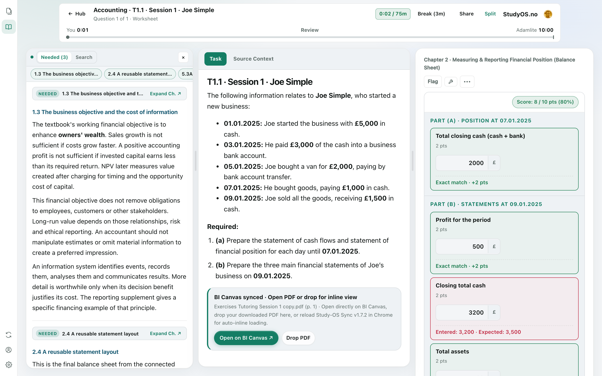
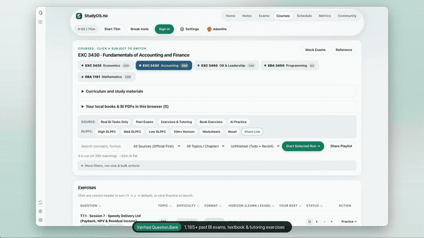
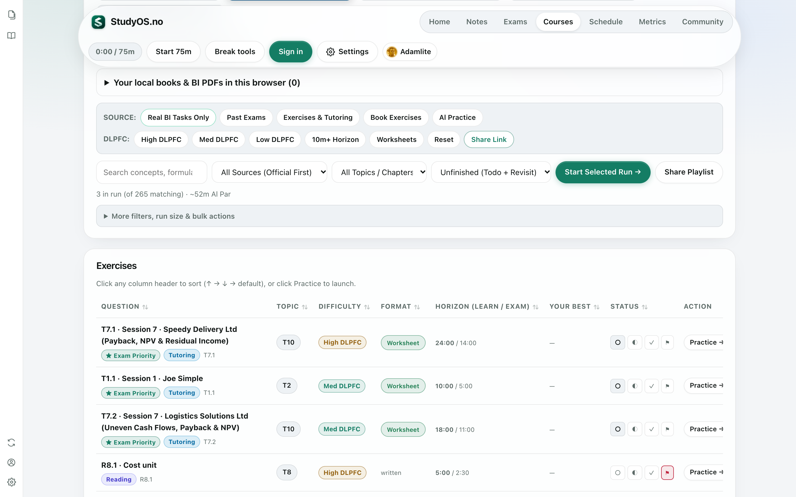
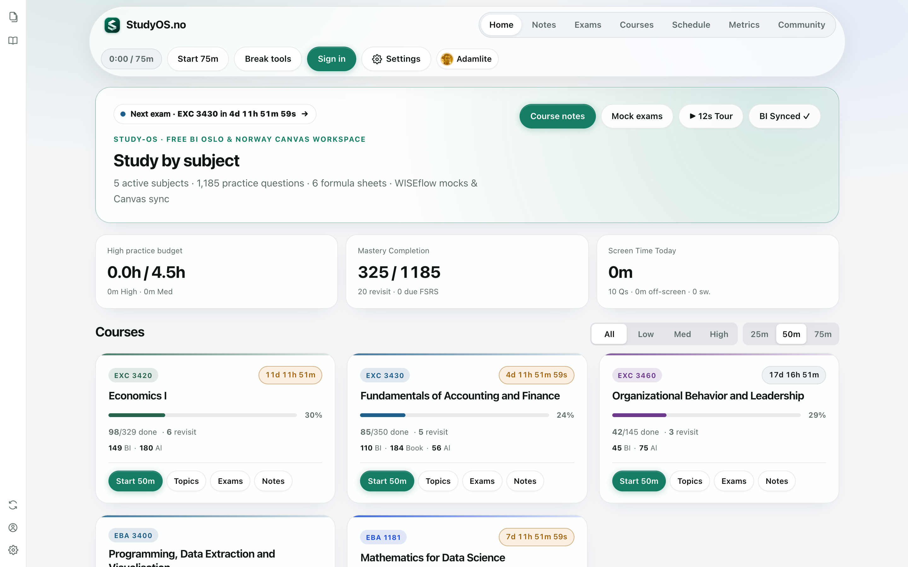
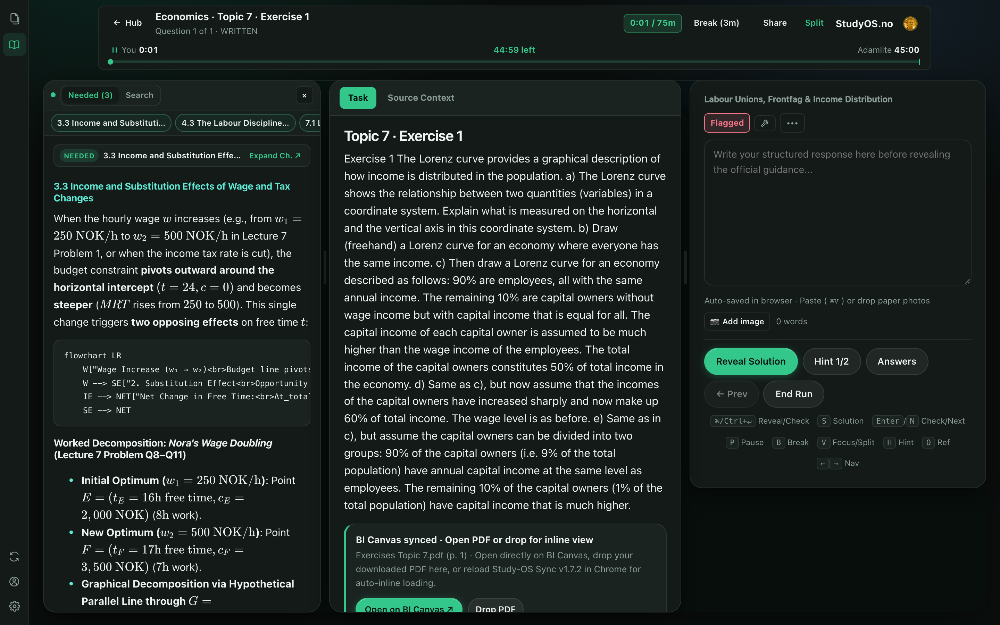
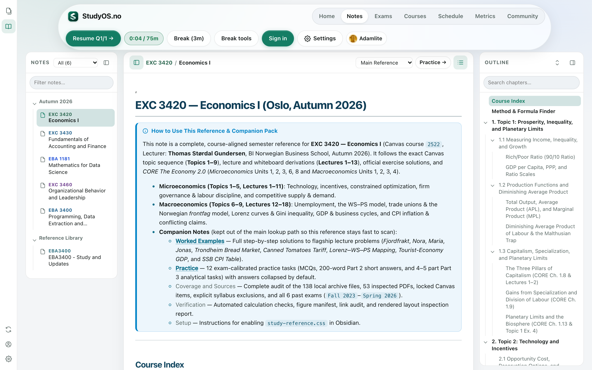
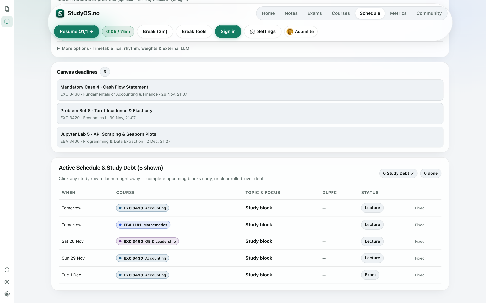
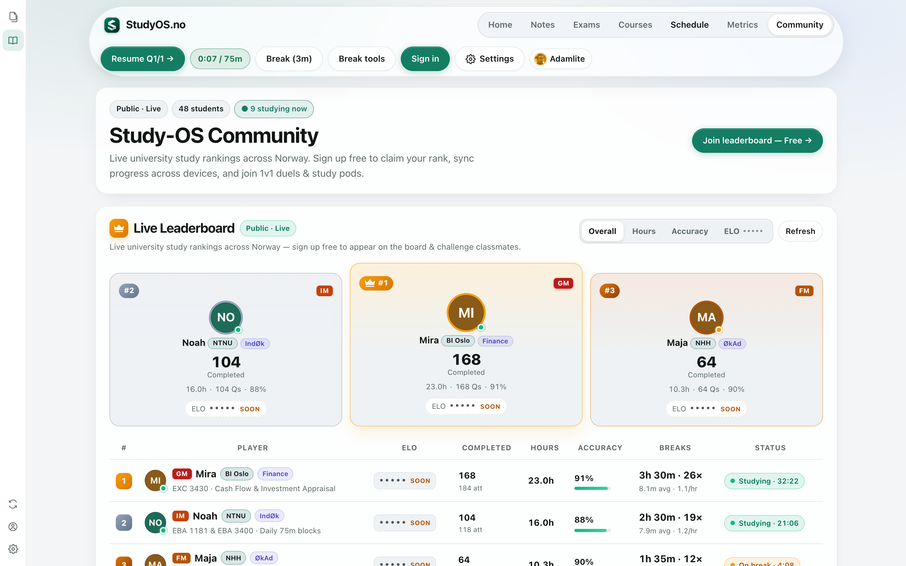
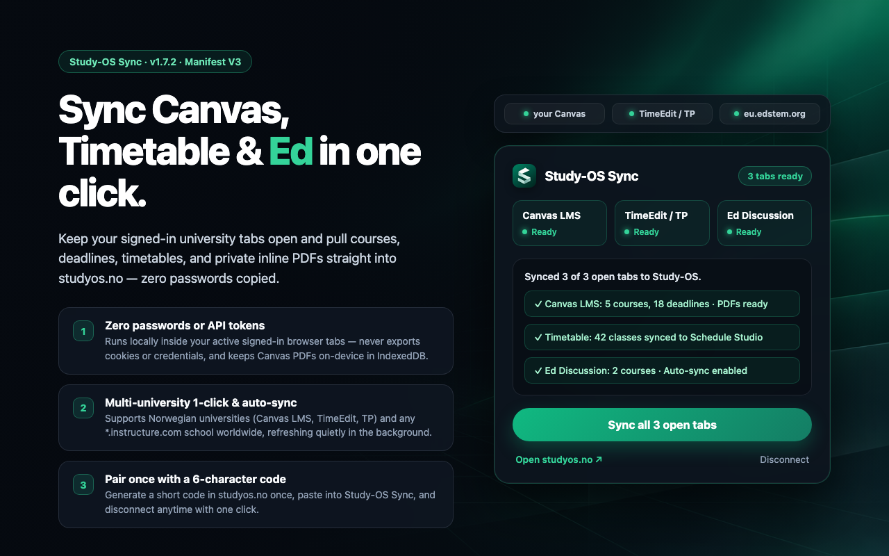
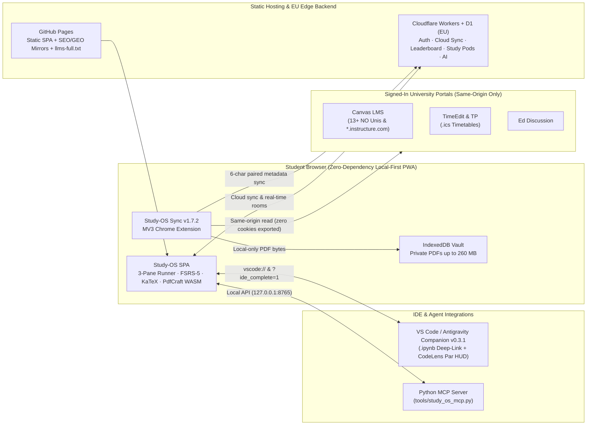

<div align="center">

<br/>

<a href="https://studyos.no/">
  
</a>

<h1>Study-OS</h1>

<p>
  <strong>The university study workbench; an open-source, local-first workspace for verified exams, course notes, timetables, and Canvas sync.</strong><br/>
  Practice past exam problems beside comprehensive reference sheets, fill interactive accounting worksheets with instant feedback, pace against AI-Par timers, and sync Canvas &amp; TimeEdit in one click.<br/>
  Web · macOS · Windows · Linux · Chrome Extension · VS Code
</p>

<p>
  <a href="LICENSE"></a>
  <br/>
  <br/>
  
  <a href="https://github.com/shadjosef/study-os/actions/workflows/ci.yml"></a>
  <a href="https://github.com/shadjosef/study-os/actions/workflows/pages.yml"></a>
</p>

<p>
  <a href="https://studyos.no/"><strong>Study-OS on studyos.no</strong></a> ·
  <a href="https://studyos.no/notes.html">Course Notes</a> ·
  <a href="https://studyos.no/bi-canvas-timeedit-sync.html">Chrome Extension</a> ·
  <a href="https://studyos.no/universities.html">13+ Universities</a> ·
  <a href="https://studyos.no/norsk.html">Norsk</a>
</p>

<br/>

<a href="https://studyos.no/">
  
</a>

<p><sub>Study-OS in 3-pane split mode — context-matched reference notes, exam task, live AI-Par pace bar, and auto-graded accounting worksheet side by side.</sub></p>

</div>

> [!NOTE]
> **Built in Oslo for university exam season.** Study-OS is free, ad-free, and open source (`MIT`). Works out of the box with 1,185+ curated BI Norwegian Business School exercises and connects to **13+ Norwegian universities** (BI, NTNU, UiO, NHH, UiB, UiA, OsloMet, UiS, UiT, USN, NMBU, HVL, Kristiania) and any `*.instructure.com` Canvas school.

<p align="center">
  <a href="#walkthrough">Walkthrough</a> ·
  <a href="#verified-exercises--interactive-worksheets">Verified Exercises</a> ·
  <a href="#comprehensive-reference-sheets">Reference Sheets</a> ·
  <a href="#adaptive-schedule--calendar-sync">Schedule &amp; Calendar</a> ·
  <a href="#leaderboard-study-pods--1v1-duels">Leaderboard</a> ·
  <a href="#1-click-canvas-timeedit--ed-sync">Canvas Sync</a> ·
  <a href="#vs-code-companion-ai-tutor--mcp">VS Code &amp; MCP</a> ·
  <a href="#how-its-built">How it's built</a> ·
  <a href="#get-started">Get started</a>
</p>

---

## Walkthrough

<p align="center">
  <a href="https://studyos.no/">
    
  </a>
</p>
<p align="center"><sub>Live recording: scrolling verified past-exam exercises, racing the AI-Par timer, filling &amp; grading accounting slots, opening context-matched reference sheets, inspecting the TimeEdit-synced schedule, and browsing the live leaderboard.</sub></p>

---

## Verified Exercises & Interactive Worksheets

<p align="center">
  
</p>
<p align="center"><sub>Verified question bank with source provenance (Past Exams, Tutoring, Book Exercises, AI Practice), difficulty tiers, and Learn/Exam AI-Par pacing targets.</sub></p>

- **1,185+ curated exercises across 5 core subjects.** Filter by source (`Real BI Tasks Only`, `Past Exams`, `Exercises & Tutoring`, `Book Exercises`, `AI Practice`), topic, worksheet format, or cognitive difficulty (`High / Med / Low DLPFC`).
- **Fill-in-the-slot accounting worksheets.** Enter numeric answers directly into structured multi-part statements and get instant right/wrong grading, exact expected values, exam pitfalls, and worked solutions.
- **Live counting timer vs. AI Par.** Every question runs a live pace bar comparing your elapsed time against the calibrated `Adamlite Par` horizon (`Beat-AI` accuracy-gated mastery + FSRS-5 spaced repetition).
- **Light and dark themes, both designed to be easy on the eyes for long sessions.**

<table>
  <tr>
    <td width="50%" align="center">
      <br/>
      <sub>Course Hub in light mode with live mastery bars and exam countdowns</sub>
    </td>
    <td width="50%" align="center">
      <br/>
      <sub>3-pane workspace in dark mode with KaTeX notes open beside the task</sub>
    </td>
  </tr>
</table>

---

## Comprehensive Reference Sheets

<p align="center">
  
</p>
<p align="center"><sub>Course-aligned semester reference sheets with chapter outline, formula finder, worked flagship problems, and instant search.</sub></p>

- **Auto-matched `Needed` notes inside the runner.** While solving any problem, open the left reference rail (`O`) to jump straight to the exact chapter sections, balance-sheet layouts, and KaTeX derivations required for that question.
- **Full semester coverage, fast to scan.** Organized by lecture sequence with worked examples, diagrams, and companion audit tables — readable standalone on the web or offline as a PWA.
- **Private inline PDF reader.** Powered by a client-side PdfCraft WASM viewer and IndexedDB vault (up to 260 MB) so your own textbooks, slides, and synced Canvas PDFs open right inside the workspace without ever touching a server.

---

## Adaptive Schedule & Calendar Sync

<p align="center">
  
</p>
<p align="center"><sub>Schedule Studio with live TimeEdit lecture sync, weekly paid-work adjustment, Canvas assignment deadlines, and circadian dlPFC study blocks.</sub></p>

- **Calendar-integrated study planning.** Sync lectures automatically from **TimeEdit / TP** (`.ics`) alongside **Canvas** assignment deadlines, and export your planned study blocks back to `.ics`.
- **Circadian `High / Med / Low-dlPFC` slotting.** Set your wake-up time (with 8h sleep protected) and weekly paid work hours (`0–45h/wk`); Study-OS schedules heavy analytical blocks in peak morning focus and lighter recall in the evening.
- **Early completion & Study Debt rollover.** Finish upcoming blocks ahead of schedule (`Done early ✓`), or let missed blocks roll transparently into a visible **Study Debt** stack until cleared.

---

## Leaderboard, Study Pods & 1v1 Duels

<p align="center">
  
</p>
<p align="center"><sub>Chess-style public leaderboard with GM / IM / FM titles, live study presence, university &amp; major badges, and timed break rooms.</sub></p>

- **Chess-style progression (`GM / IM / FM / CM`).** Earn titles from verified study hours, completed questions, and accuracy — filterable by Overall, Hours, Accuracy, or ELO.
- **Timed Study Pods & 1v1 Rated Duels.** Join 25m / 50m / 75m group study sessions, challenge classmates to 5-minute timed duels, or share filtered question playlists in one click.

---

## 1-Click Canvas, TimeEdit & Ed Sync

<p align="center">
  
</p>
<p align="center"><sub>Study-OS Sync (Manifest V3) pulls courses, deadlines, timetables, and private inline PDFs from your signed-in tabs with zero password or cookie export.</sub></p>

- **Pair once with a 6-character code.** Works across 13+ Norwegian universities and any `*.instructure.com` Canvas instance, quietly refreshing when you open a signed-in school tab.
- **Privacy by architecture.** Extension reads run strictly inside your active signed-in browser tab; copyrighted course PDFs stay locally in IndexedDB and never upload to Study-OS servers.

<details>
<summary><strong>Watch the 10-second pairing &amp; auto-sync walkthrough</strong></summary>
<p align="center">
  
</p>
</details>

---

## VS Code Companion, AI Tutor & MCP

- **VS Code / Antigravity / Cursor Companion (`v0.3.1`):** 1-click deep-link from coding exercises (`EBA 3400`) into exam-format `.ipynb` notebooks with automatic CSV dataset symlinks, top-of-cell per-subpart AI-Par CodeLens timers, and 1-click completion sync back to Study-OS.
- **Adamlite AI Tutor:** Docked inside the runner (`T`) with full task and reference-sheet awareness.
- **Local MCP Server (`tools/study_os_mcp.py`):** Register via stdio (`uv run --script /path/to/Study-OS/tools/study_os_mcp.py`) to let AI clients search subjects/questions, read notes, inspect telemetry, preview/apply adaptive schedules, and generate shareable [study sets](docs/study-sets-mcp.md).

---

## How it's built

Zero frontend build step and zero runtime npm dependencies — pure ES modules, CSS custom properties, Python 3.9+ stdlib, and an EU edge sync layer running near `$0/mo`.



---

## Get started

**Web (instant, no install):** Open **[studyos.no](https://studyos.no/)** — works immediately without signing up, installable as an offline PWA.

**Desktop (Python 3.9+ stdlib, zero pip packages):**

```bash
git clone https://github.com/shadjosef/study-os.git
cd study-os
python3 app/server.py
```

*(On Windows, install `tzdata` once via `py -3 -m pip install tzdata`. Double-click `Study OS.app` / `OPEN_STUDY_OS.command` on macOS or `OPEN_STUDY_OS.cmd` on Windows. See [Canvas Browser Sync](docs/canvas-browser-sync.md) and [`community/README.md`](community/README.md) for extension and backend details.)*

**Build, audit & CLI tools:**

```bash
python3 tools/cli.py rebuild-catalog            # Validate schemas, assets & refresh catalog
python3 tools/cli.py status                     # Print live UPI & course telemetry JSON
python3 tools/build_public_site.py --out dist   # Build static website bundle
python3 tools/seo_audit.py --dir dist           # Audit all 23 sitemap URLs, .md mirrors & llms-full.txt
```

<details>
<summary><strong>Encrypted Member Library &amp; GitHub Pages Self-Hosting</strong></summary>

- **Member library:** Paste a shared access string on the website to decrypt local question banks and linked source excerpts in-browser (**Remember on this browser** stores a non-extractable key; **Lock full library** clears it). Build or rotate keys with `tools/build_member_library.py` (Python + `cryptography`, keeping key files outside Git) and publish `study-os-members.zip` to a GitHub prerelease referenced by `site-pack/member-archive.json`.
- **Self-hosting:** Run `python3 tools/build_public_site.py --sync-pack --cname yourdomain.me` and push to `main` — `.github/workflows/pages.yml` deploys automatically after `.github/workflows/ci.yml` passes Python `-Werror`, JS syntax, VSIX/MV3 validation, SEO/GEO audit, and headless Chromium E2E tests.

</details>
