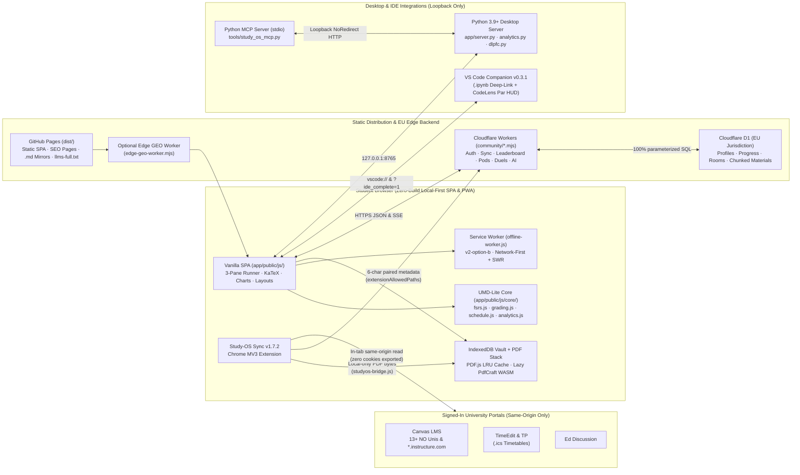

# Study-OS Architecture

Study-OS is a local-first, zero-dependency university study workbench designed to run offline as a Progressive Web App (`studyos.no`), locally via Python stdlib (`http://127.0.0.1:8765`), and optionally with an EU-resident Cloudflare Workers + D1 backend at near-`$0/mo` operating cost.

---

## System Overview

---

## 1. Zero-Dependency Local-First SPA & Modular Core

### Frontend Architecture (`app/public/`)
- **No build pipeline or runtime npm dependencies:** The SPA loads vanilla ES/IIFE modules directly (`app.js`, `runner.js`, `render.js`, `community.js`, `ai-tutor.js`, `duels.js`, `rooms.js`, `metrics-charts.js`, `local-sources.js`, `members.js`, `pdf-reader.js`, `pdfcraft-editor.js`, `layouts.js`, `schedule-tools.js`, `study-sets.js`).
- **Dual-runtime UMD-lite core (`app/public/js/core/`):**
  - `fsrs.js`: FSRS-5 power-law retrievability, stability/difficulty updates, attempt grade suggestions, difficulty overrides, and effective DLPFC step-down/escalation.
  - `grading.js`: BI WISEflow `FLOWmulti` numeric parser (dot-decimal enforcement, accounting-parentheses rejection, currency/space stripping, `±2%` / `±0.02` tolerance grading), multi-slot worksheet grader, and Norwegian ECTS grade scale.
  - `schedule.js`: Sleep-window derivation (`deriveSleepWindow`), weekly study-budget estimation, circadian DLPFC target routing, 14-day overdue Study Debt detection (`SCHED_DEBT_WINDOW_MS`), and block timing state resolution.
  - `analytics.js`: Weighted UPI & calibrated AI-Par math, verification tier classification, Oslo study streaks, topic mastery matrix, exam attempt summaries, closed-book independence tracking, and daily/weekly/monthly chart bucketing.
  - Each module attaches to `window.StudyCore` in the browser and exports via `module.exports` in Node (`node --test`), with static type verification via JSDoc + [`jsconfig.json`](../jsconfig.json) (`checkJs: true`, `strictNullChecks: true`, `noUnusedLocals: true`, `noUnusedParameters: true`).

### Local Storage, Private PDF Vault & Embedded PdfCraft WASM
- **Local-first persistence:** Practice state, FSRS cards, attempt logs, timers, and custom schedules persist in `localStorage` on the static web app (or `data/state/progress.json` + `data/logs/*.jsonl` on desktop) without requiring an account.
- **IndexedDB PDF Vault & PDF.js (`app/public/js/pdf-reader.js`):** Personal textbooks, slides, and Canvas-synced PDFs (up to **260 MB** per file) remain exclusively inside browser IndexedDB — copyrighted PDFs never upload to public Study-OS servers. PDF.js (`app/public/vendor/pdfjs/`) warms on browser idle and maintains LRU document (`MAX_DOC_CACHE = 10`) and rendered-bitmap (`MAX_BITMAP_CACHE = 28`) caches.
- **Lazy-loaded PdfCraft WASM Editor (`app/public/js/pdfcraft-editor.js`):** Embeds the official pure-Rust `storytold/pdfcraft` web WASM release (`site-pack/pdfcraft-web.json`, verified via SHA-256 at build time and excluded from Service Worker precache so initial loads pay zero WASM cost). Communicates through a same-origin `?host=parent` `postMessage` bridge (`pdfcraft:ready`, `pdfcraft:open`, `pdfcraft:save`, `pdfcraft:saved`, `pdfcraft:dirty`, `pdfcraft:failed`).
- **Optional encrypted member library (`app/public/js/members.js`, `tools/build_member_library.py`):** Decrypts local archive bundles in-browser using Web Crypto; "Remember on this browser" stores a non-extractable key, and "Lock full library" clears it.

---

## 2. FSRS-5 Cross-Language Parity & Circadian DLPFC Scheduling

Study-OS mirrors its spaced-repetition and cognitive-load algorithms across the Python desktop engine (`app/analytics.py`, `app/dlpfc.py`) and browser JS core (`app/public/js/core/fsrs.js`, `app/public/js/core/schedule.js`):

| Mechanism | Python Desktop (`app/`) | Browser Core (`app/public/js/core/`) | Key Parameters |
| --- | --- | --- | --- |
| **FSRS-5 Retrievability** | `analytics.py#update_fsrs_card` | `fsrs.js#computeFsrsRetrievability` | `R(t, S) = (1 + t / (9 * S))^-1` (`R(0) = 1.0`, `R(S) = 0.9`) |
| **FSRS-5 State Update** | `analytics.py#update_fsrs_card` | `fsrs.js#updateFsrs5Card` | Init `S`: `{1: 0.4, 2: 1.2, 3: 3.2, 4: 7.5}` days; difficulty clamped `[1, 10]`; max `S = 365d`; lapse (`grade = 1`) reschedules in `0.04d` (~1h) |
| **Beat-AI & Grade Auto-Suggest** | `analytics.py#compute_attempt_metrics` | `fsrs.js#suggestFsrsGrade` | Accuracy-gated zero-hint Beat-AI (`qualityAccuracy >= 0.85`, `hintsUsed == 0`, `!assisted`, `effectiveSec <= aiParSec`); UPI difficulty multipliers (`1: 0.85×`, `2: 1.00×`, `3: 1.22×`, exam `1.08×`, self-graded `0.45×`) |
| **DLPFC Cognitive Load Tiers** | `dlpfc.py#classify_intrinsic_dlpfc`, `effective_dlpfc_tier` | `fsrs.js#effectiveDlpfc` | Tier 3 (`high_dlpfc`, novel synthesis), Tier 2 (`med_dlpfc`, procedural drills), Tier 1 (`low_dlpfc`, recall). Struggle/revisit/lapse escalates; mastery chunks down (`reps >= 2, stability >= 5d` → Tier 1) |
| **Circadian Routing & Study Debt** | `dlpfc.py#circadian_dlpfc_target`, `timetable_planner.py` | `schedule.js#deriveSleepWindow`, `resolveBlockEffectiveState` | `HIGH_DLPFC_DAILY_CAP_MIN = 270` (`4.5h/day`), wake-relative peak/afternoon/evening windows, 14-day overdue Study Debt rollover |

---

## 3. EU Cloudflare Workers + D1 Edge Architecture (`community/`)

The optional cloud backend runs as a single modular Cloudflare Worker backed by Cloudflare D1 provisioned with `--jurisdiction eu` (`community/schema.sql`):

| Module | Responsibilities |
| --- | --- |
| `worker.mjs` | Request router, strict CORS enforcement, base security headers, streaming JSON body caps, public leaderboard (`Cache-Control: public, max-age=15`), profile/chat/DM/block/share endpoints |
| `auth.mjs` | WebAuthn Passkeys (atomic single-use 5-min challenges, RP ID hash verification, `crossOrigin` rejection, signature counter validation), Google Sign-In (`RS256` JWKS verification of `aud`/`iss`/`email_verified`/`exp`/`nbf`), 5-min 6-char device link codes, 160-bit recovery keys (SHA-256 hashed), multi-device session revocation (max 25 sessions, 10 passkeys/profile) |
| `sync.mjs` | Cross-device progress, FSRS, schedule, custom set, and Canvas metadata sync (`MAX_PAYLOAD_BYTES = 500 KB`, strict schema sanitization, prototype-pollution key stripping) |
| `timeedit.mjs` | Server-side timetable `.ics` fetch/push strictly allowlisted to `cloud.timeedit.net`, `tp.educloud.no`, and `tp.uio.no` (`redirect: 'error'`, 2 MB cap, private/IPv4/IPv6 literal host rejection) |
| `materials.mjs` | Strictly per-profile private curriculum file sync in D1 chunks (`240 KB` raw chunks, `50 MB`/file, `200 MB`/user, `100` files max, MIME allowlist, atomic quota enforcement, `CSP: default-src 'none'; sandbox` on download) |
| `ai.mjs` | Streaming SSE Socratic tutor ("Adamlite"): primary Google Gemini API with automatic fallback to Cloudflare Workers AI (`env.AI`), daily per-user quota (40/day default, 200/day admin), sanitized upstream error handling |
| `rooms.mjs` / `duels.mjs` | Timed group study pods (`25/50/75m`) and 5-minute rated 1v1 duels with server-side grading and D1-triggered Elo updates |
| `courses.mjs` / `admin.mjs` / `feedback.mjs` | Deduplicated Community Courses catalog, invite-code/member admin controls, feedback intake |
| `human.mjs` | Cloudflare Turnstile verification (`signup`, `link`, `recovery` actions with hostname binding) + `AUTH_RATE_LIMIT` throttling (`429`) across all public auth endpoints |
| `edge-geo-worker.mjs` | Optional reverse-proxy Worker for `studyos.no` providing `Accept: text/markdown` content negotiation (`Vary: Accept`), `Link` discovery headers, and PII-free AI crawler daily hit counters in D1 |

### Security Model Summary
- **Strict CORS:** Exact allowlist from `WEB_ORIGIN` and `WEB_ADDITIONAL_ORIGIN`, plus `chrome-extension://<id>` (optionally pinned via `CHROME_EXTENSION_IDS`) restricted to `extensionAllowedPaths` (`/auth/extension-link`, `/courses/sync`, `/schedule/timeedit-push`, `/schedule/timeedit-feed`, `/profile`). Zero wildcard reflection; `Access-Control-Allow-Credentials` is never emitted.
- **SQL & Payload Hygiene:** 100% parameterized D1 queries (`?` bindings), constant-time 64-hex digest comparison (`equalProof`), streaming byte limits (`64 KB` standard, `512 KB` sync/chunks/feedback, `2.1 MB` ICS/AI, HTTP `413` on overflow), and forbidden-key filtering (`__proto__`, `constructor`, `prototype`).
- **Headers & Error Isolation:** `X-Content-Type-Options: nosniff`, `Referrer-Policy: strict-origin-when-cross-origin`, `X-Frame-Options: DENY`, and `Cache-Control: no-store` on authenticated/sync responses; internal exceptions never leak stack traces or upstream provider details.
- **Automated Verification:** Covered by `tests/worker/security.test.mjs` (runs in CI via `node --test`).

---

## 4. Static Site Generator, PWA Cache Lifecycle & SEO/GEO Pipeline

### Build & Audit Pipeline (`tools/`)
1. **`tools/build_public_site.py`**:
   - Copies `app/public/`, injects cache-busting asset hashes, and exports copyright-safe course banks (`5` public courses, `1,185+` exercises) + Obsidian reference sheets & rewritten SVG assets into `dist/static-data/`.
   - Packages `canvas-sync-extension/` into `dist/downloads/study-os-sync-extension.zip` (excluding store assets/dev files) and optionally unpacks SHA-256-verified `member-library/` and `pdfcraft/` archives.
2. **SEO & Generative Engine Optimization (`tools/seo_pages.py`, `tools/geo_markdown.py`)**:
   - Generates static, indexable landing pages (`/bi-oslo.html`, `/norsk.html`, `/universities.html`, `/wiseflow-practice.html`, `/gpa-calculator.html`, `/compare.html`, `/notes.html`, `/courses/*.html`, `/uni/*.html`) styled with lightweight `seo.css` (`< 25 KB`) and structured JSON-LD + reciprocal `hreflang`.
   - Emits clean, HTML-free Markdown mirrors (`.md`) for every public page (advertised via `<link rel="alternate" type="text/markdown">`), plus `/llms.txt`, `/llms-full.txt`, and `/sitemap.xml`.
3. **Automated QA (`tools/seo_audit.py` + `tools/smoke_test_e2e.mjs`)**:
   - Validates every sitemap URL, canonical/hreflang reciprocity, `robots.txt` conflicts, `noindex` utility pages, zero broken internal links, `.md` mirrors, A11y landmarks, Core Web Vitals (`CLS < 0.05`), mobile `390×844` overflow, and Service Worker integrity.

### PWA Cache Lifecycle (`app/public/offline-worker.js`)
- **Build-time manifest injection:** `build_public_site.py` hashes `v2-option-b` + the Service Worker template + all precached assets and prepends `self.__STUDY_OS_VERSION__` and `self.__STUDY_OS_ASSETS__` to `dist/offline-worker.js`.
- **Cache key & exclusions:** Opens `study-os:<scope>:v2-option-b:<version>`, precaches core SPA assets + `js/core/*.js` + Option B icons (`favicon.ico`, `pwa/favicon-48.png`, `pwa/favicon-96.png`, `pwa/study-os-192.png`, `pwa/study-os-512.png`), and explicitly **never** caches `offline-worker.js` itself, `/api`, `/auth`, `/pdfcraft`, `/downloads`, `/member-library`, `Authorization` requests, or `no-store`/`private`/`Set-Cookie` responses.
- **Fetch strategies:**
  - **Navigations (`request.mode === 'navigate'`):** Network-first with fallback chain (exact cached page → cached `index.html` → cached `404.html` → embedded `OFFLINE_HTML`).
  - **Same-origin static assets:** Stale-while-revalidate with background refresh via `event.waitUntil`.
- **Lifecycle:** Registered on demand when a student clicks **Save for offline** (`app.js#saveForOffline`) and checked for updates (`reg.update()`) on subsequent loads; `install` calls `skipWaiting()`, and `activate` purges older `study-os:<scope>:` caches before `clients.claim()`.

---

## 5. Extensions, IDE Companion & MCP Bridge

- **Chrome Sync Extension (`canvas-sync-extension/`, v1.7.2, Manifest V3):**
  - Uses `scripting`, `storage`, and `alarms` (plus optional `tabs` for opt-in local domain-category focus counters and optional `http://127.0.0.1/*` for desktop sync).
  - Scoped host permissions cover 13+ Norwegian universities, `*.instructure.com`, TimeEdit/TP, Ed Discussion, and the Study-OS Worker API.
  - Injects same-origin collector functions directly into the student's signed-in tabs (zero password reading, zero cookie export), supports 12h Canvas/Ed & 72h TimeEdit auto-sync cooldowns, and bridges local Canvas PDFs straight into the Study-OS tab's IndexedDB vault via `studyos-bridge.js`.
- **VS Code / Antigravity / Cursor Companion (`tools/study-os-vscode/`, v0.3.1):**
  - Pure VS Code API extension (`extension.js`), built into `app/public/downloads/study-os-companion.vsix` via zero-dep `build_vsix.py`.
  - Handles `vscode://study-os.companion/...` deep-links from programming exercises (`EBA 3400`), scaffolds exam-format `.ipynb` notebooks, symlinks local CSV datasets automatically, displays per-subpart AI-Par timers via top-of-cell CodeLens HUD with configurable idle auto-pause, and returns completion telemetry to Study-OS via `?ide_complete=1`.
- **Local Desktop Server (`app/server.py`) & Python MCP Server (`tools/study_os_mcp.py`):**
  - `app/server.py` binds exclusively to loopback (`127.0.0.1:8765`) using Python's `ThreadingHTTPServer`, serving the SPA and persisting student state under `data/`.
  - `tools/study_os_mcp.py` runs as a local `stdio` FastMCP server (`NoRedirect` loopback HTTP client) exposing read/write tools (`list_courses`, `get_current_exercise`, reference/file readers, analytics telemetry, adaptive schedule preview/apply, and shareable study-set generation) with strict Socratic defaults and blind-exam lockouts (`mode == 'blind'` suppresses all hints and solutions).
